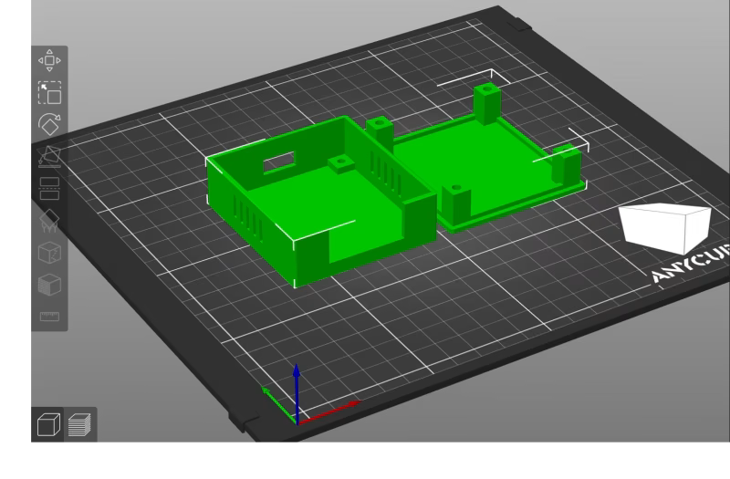
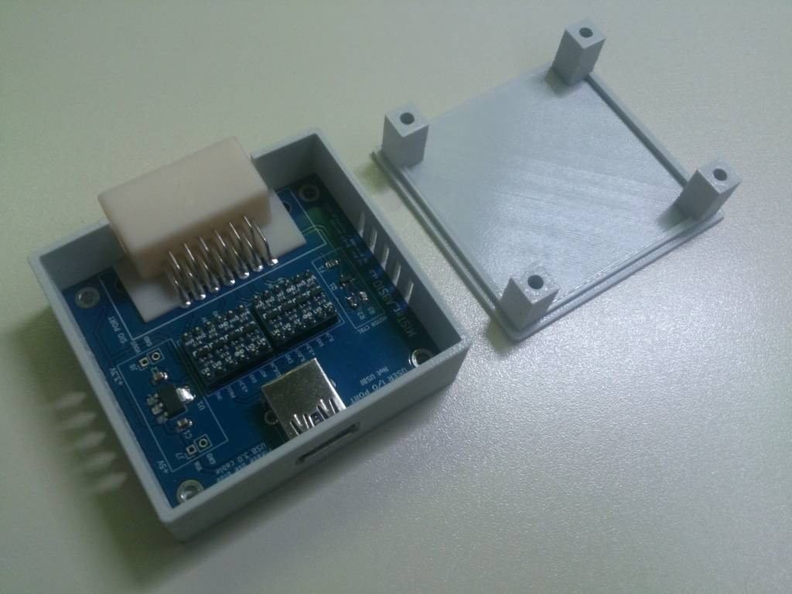
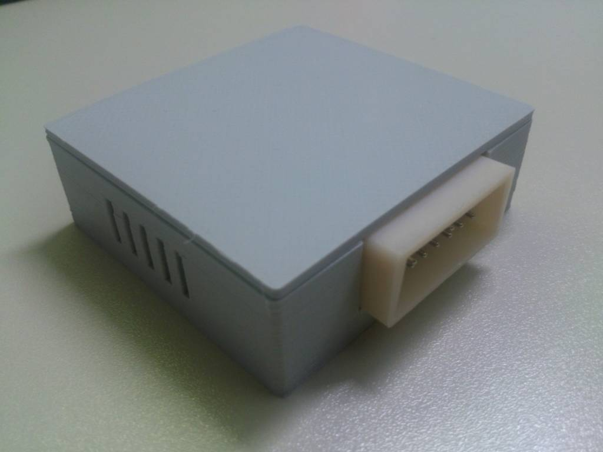

## A simple housing for the A8SIO interface

You can optionally use M3*12 screws with or w/o brass knurled nuts.  
May need support for the vents and USB opening - please check with your 3D printer/settings.

